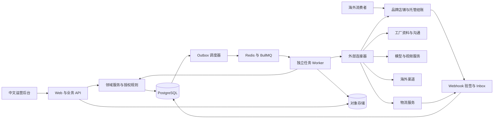

# 技术架构与数据设计

版本：v0.1 / 2026-09-06。以下为工程决策，尚未初始化应用或锁定依赖补丁版本。

## 1. 技术选择

| 层 | 默认技术 | 选择原因与边界 |
|---|---|---|
| 运行时 | Node.js 24 LTS、TypeScript、pnpm workspace | 前后端共享契约，支持本地 Windows 与 Linux 部署 |
| 运营前端与 HTTP API | Next.js App Router、React | 一个 Web 应用处理页面、会话和轻量接口；长任务不占 HTTP 请求 |
| UI | Tailwind CSS、Radix primitives、Lucide | 共享 token 与可访问交互；不依赖重型后台主题 |
| 数据 | PostgreSQL、Drizzle、Zod | 业务状态持久化，数据库约束和输入校验 |
| 异步执行 | BullMQ、Redis、独立 Node worker | 调度与并发；数据库保留持久工作流，Redis 不做业务真相来源 |
| 资产 | S3 兼容对象存储 | 原素材、渲染结果、证据附件；数据库保存索引和哈希 |
| 内容渲染 | FFmpeg 模板剪辑 + 可替换的 TTS/生成视频服务 | 先完成可靠商品视频；不首发复杂时间线编辑器 |
| 店铺 | Shopify 主题店铺、GraphQL Admin API、webhooks | 复用消费者购买、支付与订单；不首发 headless 店铺 |
| 模型 | 统一 ProviderAdapter，支持文本/视觉/结构化输出能力声明 | 具体供应商由预算、可用性和评测决定，不绑定单一模型 |
| 观测与测试 | 结构化日志、OpenTelemetry 接口、Vitest、Playwright | 请求/任务追踪、业务计算和恢复测试、浏览器验收 |
| 部署 | Linux 容器、托管 PostgreSQL/Redis/对象存储优先 | 小团队可维护；初期无需 Kubernetes |

Node.js 官方列出 24 为 LTS；Next.js 官方提供 App Router 与 TypeScript 路径。开工时复核兼容性、补丁安全与授权，精确版本写入 lockfile，不能把文档中的选型视为已安装。[Node.js](https://nodejs.org/en/about/previous-releases) · [Next.js](https://nextjs.org/docs/app/getting-started/installation)

## 2. 系统边界



首版是模块化单体代码库，运行 Web 与 Worker 两类进程。领域逻辑共享，禁止 Worker 和 Web 各实现一套价格/权限规则。任务队列仅指示“需要处理什么”，消费时查询数据库权威状态。

## 3. 权威数据与写入责任

| 数据 | 权威来源 | AgentSale 的责任 |
|---|---|---|
| 商品原始事实、核实结果 | 来源证据 + 人工确认版本 | 维护事实和引用，记录冲突 |
| 待发布商品/文案 | AgentSale 草稿版本 | 校验后同步；保留内容版本 |
| 已发布价格与可售状态 | 店铺当前记录 | 同步对账；漂移时告警/暂停，不盲目覆盖 |
| 付款与退款结果 | 店铺/支付平台 | 经过验签回调并在必要时主动查询确认 |
| 供货报价/库存 | 工厂或履约服务商记录 | 保存时间与有效期，过期不承诺可售 |
| 物流进展 | 承运商或核实的人工证据 | 映射规范状态，保留原始状态 |
| 工作流、授权、审阅 | AgentSale 数据库 | 唯一写入入口为领域服务 |
| AI 输出 | 无权威性，属于候选结果 | 结构校验、证据验证与政策判断后才能执行 |

## 4. 目录设计（后续创建）

```text
apps/
  console/                 # Next.js 运营后台、API、webhook 接收入口
  worker/                  # 任务消费、定时对账、媒体渲染入口
packages/
  domain/                  # 商品、供应、客户、订单、利润、授权服务
  contracts/               # Zod schema、错误码、事件及 connector 契约
  database/                # schema、迁移、事务、RLS 与 repository
  agent-runtime/           # 工作流、步骤、提案、预算和恢复
  connectors/              # commerce、research、messaging、media、logistics
  ui/                      # 设计 token 和共享组件
  media/                   # 视频模板、字幕、渲染与质量检查
testdata/                  # 明确标识的虚构数据、回调、故障 fixtures
tests/                     # 领域、集成、契约、端到端测试
infra/                     # 本地容器、部署配置、备份恢复说明
docs/plan/                 # 当前方案
docs/design/               # 样稿、设计资源
docs/reports/              # 测试报告与交付证据
```

初期通过 packages 内子模块组织业务，不把每个业务模块部署成微服务。媒体渲染进程按 CPU/内存独立限额；未来按真实瓶颈拆分，不提前引入服务网格或多区域一致性。

## 5. 核心数据模型

所有业务表有 `id / workspace_id / created_at / updated_at / version`，枚举显式定义；UTC 存储时间，界面按工作区或客户时区展示。

| 实体 | 关键字段与关系 |
|---|---|
| Workspace / Membership | locale、timezone、mode；角色、用户、成员状态 |
| Market | country、language、currency、shipping_policy、readiness |
| Supplier | legal_name、region、type、verification_status、evidence_ids |
| SupplierContact / Agreement | 渠道、联系许可、合作条款版本、适用 SKU、有效期 |
| Product / Variant | 规格、规格版本、SKU、素材、事实主张；variant 唯一归属 product |
| SourceEvidence / Claim | 来源 URL/文件、抓取时间、哈希、摘录、核实状态、适用范围 |
| SupplierOffer | supplier + variant、成本币种、MOQ、库存时间、报价有效期、包装尺寸 |
| MarketAssessment | product + market、输入版本、证据覆盖、成本场景、结论 |
| Listing | store + variant + market、外部 ID、发布版本、可售状态与同步时间 |
| Asset / Content | 对象路径、授权、哈希；脚本、claim 引用、语言、渲染状态 |
| Campaign / Publication | market、预算、experiment；内容、渠道、回执、归因参数 |
| Customer / Conversation / Message | 语言、地区、联系偏好、原文、译文、外部消息 ID |
| SalesOrder / OrderLine | 外部订单 ID、付款状态、原币金额、变体/报价/归因快照 |
| PurchaseOrder / PurchaseLine | supplier、客户订单行分配、接单状态、采购金额 |
| Shipment / ShipmentLine | 承运商、跟踪号、采购行数量、状态证据 |
| AfterSale / Refund | 原订单与行、理由、金额、处理状态、外部退款 ID |
| CostEntry / FXRate | 成本类型、估算/实际、凭据、分摊规则、币种、汇率快照 |
| Experiment / MetricObservation | 假设、阈值、预算、时间窗、样本量、测量来源 |
| WorkflowRun / Step | 目标、状态、checkpoint、run_version、next_attempt_at、锁租约 |
| ActionProposal / Approval | 动作参数哈希、证据版本、规则版本、有效期、批准人 |
| ExternalAction / Receipt | 幂等键、操作类型、external_id、发送状态、回执与确认时间 |
| ConnectorAccount / Capability | secret_ref、scope、health、可执行动作、授权状态 |
| BudgetReservation | scope、上限、已预留/实耗、币种、过期及对账状态 |
| InboxEvent / OutboxEvent / AuditEvent | 接收去重、可靠派发、不可覆盖的操作记录 |

数据库约束：外部 ID 唯一范围包含 workspace、store/account/provider；SKU 只在工作区内唯一；金额不能为不合法精度；外键包含工作区范围；采购/发货数量不可超过分配数量（退换货按独立事务处理）。退款累积不得超过可退额。

## 6. 关键接口契约

统一前缀 `/api/v1`，服务端从认证会话解析 workspace，不信任请求体提供的租户标识。写操作带 `Idempotency-Key`；更新与批准带 `expectedVersion`。

| 接口 | 行为 |
|---|---|
| `POST /opportunities/import` | 校验链接/文件，创建导入任务，返回 202 + runId |
| `POST /products/:id/assessments` | 指定 marketId、inputVersion，返回评估任务 |
| `POST /suppliers/:id/outreach-proposals` | 生成询价候选，不等于发送 |
| `POST /content/jobs` | 指定商品事实版本与模板，异步渲染 |
| `POST /actions/:id/approve` | 校验版本/有效期，保存批准并排队，不直接声称外部成功 |
| `POST /actions/:id/reject` | 原因、版本，阻止该提案后续执行 |
| `POST /runs/:id/pause`、`/resume` | 停止下一动作，恢复前重新检查状态与权限 |
| `GET /runs/:id/events` | SSE；支持断线续读游标，权限逐次验证 |
| `POST /webhooks/:provider/:accountId` | 原始体验签、持久 inbox、去重，异步消费 |
| `GET /orders/:id` | 返回支付/履约/售后分维度状态与来源 |
| `GET /connectors/capabilities` | 返回可用动作、限制与最近验证时间 |

标准失败示例：`{ code: "CAPABILITY_UNAVAILABLE", message: "当前账号未开通公开发布", retryable: false, runId, requiredAction: "export_for_manual_publish" }`。保留 `INPUT_INVALID / VERSION_CONFLICT / AUTH_EXPIRED / BUDGET_EXCEEDED / RATE_LIMITED / RESULT_UNKNOWN / SOURCE_STALE`。

分页 cursor、列表默认 25 条，服务端搜索、排序和过滤。异步结果可查询，不能只靠前端 toast 保存任务进度。

## 7. 可靠任务和交易边界

1. API 在同一数据库事务创建业务意图、步骤与 outbox。
2. 调度器读取 outbox 投递队列；重复投递允许，步骤 claim 使用数据库锁/租约防并发。
3. Worker 读取最新事实、权限、预算，执行一个有界步骤。
4. 外部动作在发送前建立 external_action 幂等记录，发送后保存回执。
5. 若进程在外部成功但本地保存前退出，状态视为 unknown：优先按幂等键/外部 ID 查询并对账。无可用查询与幂等机制时转人工，不盲目重发。
6. 步骤结果与下一步 outbox 同事务写入；有未完成步骤的任务可被定期扫描恢复。

BullMQ 重试不能代替业务幂等设计。[BullMQ 官方说明](https://docs.bullmq.io/patterns/idempotent-jobs)

Shopify webhook 必须验签、处理重复/乱序，并补充定时对账；收到旧通知不得回滚更新的订单状态。回调后根据外部资源更新时间/主动查询确认，不能仅按本地到达顺序覆盖。[Shopify webhooks](https://shopify.dev/docs/apps/build/webhooks)

## 8. 身份、数据与文件边界

- 首版邀请制成员登录，使用成熟 OIDC 提供方，不自行实现密码找回体系；会话 HttpOnly/Secure/SameSite，服务器做 RBAC、CSRF/Origin 校验与速率限制。
- PostgreSQL 开启 RLS 作为隔离补强。运行角色不得是表所有者、超级用户或 BYPASSRLS，必要表 FORCE ROW LEVEL SECURITY；事务内设置租户上下文，连接池不能泄露上次租户值。数据库迁移角色与运行角色分离。[PostgreSQL RLS](https://www.postgresql.org/docs/17/ddl-rowsecurity.html)
- 密钥只保存到秘密管理服务或加密存储，数据库用引用；浏览器、提示词、日志不包含密钥。
- URL 导入阻止内网/本机/元数据地址和重定向绕过；下载有内容类型、大小、超时和扫描限制，PDF/网页解析及 FFmpeg 在资源受限进程运行。
- 工厂网页、客户文本、文件内指令均为外部数据，不可覆盖系统规则、调用任意工具或获取其他客户信息。
- 商品公开素材与客户附件分 bucket/前缀授权；客户文件使用短期签名链接。
- 默认只把任务必要字段发送模型，客户身份字段最小化，日志脱敏。真实市场的数据保留与跨境处理规则必须在上线检查中确认。

## 9. 部署、容量与可观测性

开发环境 Windows + Docker/WSL2 或可用容器环境；初期部署一个选定区域的 Web、Worker、PostgreSQL、Redis 与对象存储。海外店铺和媒体使用 CDN；不要在未核实数据处理要求时复制客户库到多个国家。

初始容量测试目标（不是生产承诺）：5 个并发运营用户、1 万候选记录、每日 100 个研究任务、20 个视频任务、100 笔订单回调负载。媒体队列独立并发上限 1–2，外部接口按账号单独限速。

结构化日志绑定 workspaceId、runId、stepId、actionId、orderId；监测队列延迟、待确认动作、webhook 积压、预算消耗、模型失败和素材渲染失败。凭据过期是业务可见状态。

初始恢复目标：数据库备份/PITR 目标 RPO ≤ 1 小时，RTO ≤ 4 小时；必须通过恢复演练才可声称达到。对象存储版本控制；Redis 丢失后从数据库未完成步骤重建任务。每次发布执行迁移检查、冒烟、连接健康和回滚说明。

## 10. 延后项

首版不引入 Temporal、Kubernetes、独立向量数据库或微服务。长期任务先用数据库状态 + 队列；当分支补偿、跨服务工作流或运维负担明显增加时再评估 Temporal，保留步骤和连接器契约便于迁移。
